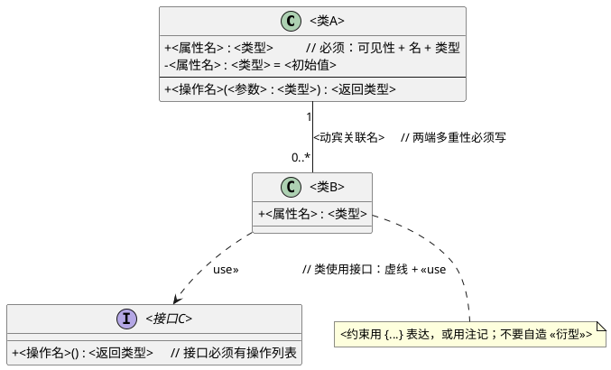

# PKMon OOA/OOD 作图规范与现图缺陷清单

## 0 执行状态（2026-11-16 更新）

26 张图已完成 **11 张**重画（含原 12 张必重画中的 6 张），全部替换进 OOA 文档：

| 引用名 | 图种 | 重画后文件 | 关键修正 |
| --- | --- | --- | --- |
| yanxin-ana-37 | 用况图 | `fig-2-1-usecase-overview.png` | 4 参与者 / 边界框 / 8 用况 / «include»×2 / «extend»×1 |
| dongxinyu-ana-01 | 用况图 | `fig-2-2-usecase-study.png` | 去掉「服务器时间」伪参与者；用况间只用 «include» |
| sunhongyi-ana-28 | 用况图 | `fig-2-3-usecase-capture.png` | 题库改为系统内注记；遭遇来源作外系统参与者 |
| dongxinyu-ana-02 | 类图 | `fig-2-2-class-study.png` | 类型位改回类型；3 条关联两端多重性；去误用聚合 |
| sunhongyi-ana-27 | 类图 | `fig-2-6-class-capture.png` | 8 条关联两端多重性；{unique}/{readonly} 约束 |
| dongxinyu-ana-04 | 状态图 | `fig-2-4-state-dwell.png` | 初/终态齐全；复合状态含子初态；entry/do/exit 成栏 |
| huhao-ana-11 | 包图 | `fig-2-8-package-modules.png` | 8 包 + 9 条虚线依赖，全部标 «import» |
| yanxin-ana-34 | 包图 | `fig-2-15-pkg-business.png` | 3 个业务包，依赖标 «import»，去掉文档路径与人名 |
| huhao-des-12 | 数据管理类图 | `fig-3-4-class-datamgmt.png` | ER 鸦爪改为 8 个 «persistent» 类 + 仓储端口，关联带多重性 |
| yuxingchen-ana-45 | 活动图 | `fig-3-5-activity-nav.png` | 「导航图」改为活动图；判定用菱形，分支写 [监护] |
| ranxinlin-des-24 | 包图 | `fig-3-6-pkg-migration.png` | 「迁移图」改为包图；依赖标 «import»/«access» |

剩余 15 张（类图 5、顺序图 6、状态图 4）在后续批次重画。

--- | --- | --- | --- |
| yanxin-ana-37 | 用况图 | `assets/diagrams-v2/fig-2-1-usecase-overview.png` | 4 参与者、1 边界框、8 用况、2 条 «include»、1 条 «extend»、2 note |
| dongxinyu-ana-02 | 类图 | `assets/diagrams-v2/fig-2-2-class-study.png` | 6 类 + 1 «boundary»；3 条关联两端多重性；4 条 «use» |
| sunhongyi-ana-27 | 类图 | `assets/diagrams-v2/fig-2-6-class-capture.png` | 7 类；8 条关联两端多重性；{unique}/{readonly} 约束 |
| dongxinyu-ana-04 | 状态图 | `assets/diagrams-v2/fig-2-4-state-dwell.png` | 初/终态、复合状态含子初态、entry/do/exit 成栏 |
| huhao-ana-11 | 包图 | `assets/diagrams-v2/fig-2-8-package-modules.png` | 8 包 + 9 条虚线依赖，全部标 «import» |

剩余 7 张（顺序图 3、状态图 2、用况图 1、包图 1 及数据管理图 1，按第 5 节优先级取前 7）待重画，规格见第 5.2 节。

---

> 适用范围：`output/PKMon第三阶段提交_20261119/assets/diagrams/` 下 59 张图（`_index.csv` 1–59 行）
> 证据来源：6 份课程课件 pdftotext 原文、文档标准模板 `5、面向对象分析设计文档.docx`、48 份 `.puml` 源、11 张仅存 PNG 的账号模块图（yanxin 34–44，无 puml）、第二阶段汇报 PPT
> 用途：主控程序据此重画关键图；本文件只给规范与规格，不改图

---

## 1 结论摘要

1. **必须重画 12 张**：`yanxin-ana-37`、`sunhongyi-ana-28`、`dongxinyu-ana-02`、`sunhongyi-ana-27`、`dongxinyu-ana-04`、`sunhongyi-ana-26`、`sunhongyi-ana-29`、`zhaoguanjun-ana-54`、`yanxin-ana-36`、`yuxingchen-ana-48`、`huhao-ana-11`、`huhao-des-12`。
2. **包图是重灾区**：8 张包图里没有一张用 «import»/«access» 标依赖，反而出现实线箭头（当关联用）和空心三角（当实现用），`ranxinlin-des-21` 直接把"实现 TokenProvider"画在包与包之间。
3. **顺序图普遍缺"对象"**：10 张顺序图的绝大部分生命线只写类名（`CaptureService`）而不写 `对象名 : 类名`，`sunhongyi-ana-29` 干脆把"答题捕获（系统边界）"画成生命线，`huhao-des-13` 把 URL `/test/hello` 画成生命线。
4. **参与者被滥用**：`dongxinyu-ana-01` 把"服务器时间"、`sunhongyi-ana-28` 把系统内部"题库"、5 张顺序图把"客户端"画成参与者，混入 `«system»` 衍型也救不回来。
5. **用况之间的关系基本没按 UML 画**：11 处用况间连线是"无构造型的实线或虚线 + 一句中文标签"，`zhaoguanjun-ana-55` 的 `include` 少了 `«»` 直接退化成文字标签，`dongxinyu-ana-01` 两个用况之间画了带箭头的实线。
6. **状态图缺的是"状态内部的东西"**：8 张状态图里 7 张没有 `entry/do/exit` 内部转移栏，`yuxingchen-ana-48` 把 `entry:`/`exit:` 写进 note，`zhaoguanjun-ana-52` 用"入口：/内部：/出口："代替 UML 关键字。
7. **监护条件写法全线失守**：状态图把条件写成 `result=CORRECT 且…`、顺序图把条件塞进消息名（`6 [有效] insert(...)`），都不符合"监护条件用方括号、放在事件之后"的格式。
8. **`dongxinyu-ana-04` 的 `PAUSED` 是坏复合状态**：框里套了 `OUTSIDE`、`NO_SIGNAL` 两个子状态，却没有子初态、也没有任何转移进出，属于课程明令要检查的"死状态"。
9. **数据管理部分没有 UML 图**：`huhao-des-12` 是 ER 鸦爪记法（`||--o{`），不是类图；全项目也找不到一张用 `«process»`/`«thread»` 标主动类的控制驱动图。
10. **图上混入人名是通病**：包名"（主责：胡豪）"、类体"引用：孙虹毅"、生命线"AuthApi（冉昕霖）"、衍型"«引用·董欣毓»"共 14 处，评审时会被直接扣分。

---

## 2 通用作图规范（G-01..G-14）

### 2.0 权威来源登记（第 2、3 节用 〔Wx〕 引用）

| 编号 | 来源 | 完整 URL |
| --- | --- | --- |
| W1 | OMG UML 2.5.1 规范（正式版，2017-12；PDF：https://www.omg.org/spec/UML/2.5.1/PDF） | https://www.omg.org/spec/UML/2.5.1/About-UML |
| W2 | Microsoft Learn《UML Class Diagrams: Reference》（关联/角色/多重性/聚合/组合/泛化/接口/实现/包导入） | https://learn.microsoft.com/en-us/previous-versions/visualstudio/visual-studio-2015/modeling/uml-class-diagrams-reference?view=vs-2015 |
| W3 | Microsoft Learn《UML Sequence Diagrams: Reference》（生命线/执行规约/同步与异步/返回/创建消息/组合片段） | https://learn.microsoft.com/en-us/previous-versions/visualstudio/visual-studio-2015/modeling/uml-sequence-diagrams-reference?view=vs-2015 |
| W4 | Microsoft Learn《UML Use Case Diagrams: Reference》（参与者/用况/子系统边界/include/extend/泛化） | https://learn.microsoft.com/en-us/previous-versions/visualstudio/visual-studio-2015/modeling/uml-use-case-diagrams-reference?view=vs-2015 |
| W5 | Sparx Systems《Enterprise Architect User Guide — StateMachines》（初态每个区域一个、复合状态、entry/exit、迁移触发器与监护） | https://sparxsystems.com/enterprise_architect_user_guide/16.1/modeling_languages/statediagram.html |
| W6 | Visual Paradigm《What is Package Diagram?》（包=文件夹符号、依赖虚线、«import» 与 «access»） | https://www.visual-paradigm.com/guide/uml-unified-modeling-language/what-is-package-diagram/ |

课件文件简称：`UML1` = `UML120261015_new_pdf.txt`；`OOA` = `OOA_20261020_人工智能时代版__new_1__pdf.txt`；`SEQ` = `顺序图_通讯图和活动图20261021_AI_Agent时代版__无答案_pdf.txt`；`STATE` = `状态图20261027_补充__1__无答案_pdf.txt`；`OOD1` = `面向对象设计OOD_1_20261027_new_AI案例版_new_pdf.txt`；`OOD2` = `面向对象设计OOD_2_20261029_AI案例版_pdf.txt`；`TPL` = `软件工程文档标准\5、面向对象分析设计文档.docx`（导出文本 `tpl5.txt`）。

### 2.1 通用条目

| 编号 | 要求 | 依据 | 违反后果 |
| --- | --- | --- | --- |
| G-01 | 图内标题、文件名、正文表述必须使用课程统一术语：用况图、参与者、类图、顺序图、状态图、包图、活动图；不得出现"导航图""核心数据关系图""迁移图""ER 图"等自造图种名。 | 〔TPL〕"用况图文档、类图文档、顺序图文档、状态图文档、包图文档"；〔W1〕UML 2.5.1 第 18 章只定义 14 种图 | 图无法对应到文档模板章节，评阅时"图种不全" |
| G-02 | 一张图只表达一个图种、一个视角。禁止包图里画构件矩形、数据库圆柱；禁止类图里画 ER 鸦爪；禁止顺序图用分隔符塞多个场景。 | 〔W2〕类图元素表只含类/接口/枚举/包/关联/泛化/实现/依赖；〔W6〕包里放的是"逻辑相关的 UML 元素" | 图种判定失败，等于该图种缺图 |
| G-03 | 图中元素名只写模型名。禁止出现负责人姓名、"（本人）""（共享）""主责：×××"、"文档：××analysis/"。责任人信息只能写进图注（note）以外的正文文档。 | 〔OOA〕"使用名词或名词性短语，避免无意义的符号和数字" | 图上出现非模型信息，被视为"AI 草稿未清洗" |
| G-04 | 每条连线的记号必须能说出关系类型（关联/泛化/实现/依赖/包含/扩展）；禁止用"一句中文标签"代替关系类型，禁止两种以上关系使用同一线型。 | 〔UML1〕"UML提供了以下4种关系术语…关联、泛化、实现、依赖" | 关系不可读，类图/用况图判为不合格 |
| G-05 | 依赖方向一律"源→目标"，箭头指向被依赖者；包间依赖必须带 «import» 或 «access»，且不得与实现（空心三角）混用。 | 〔UML1〕"并分别标记为《import》和《access》"；〔W6〕"The dotted arrows are dependencies … two sub-types … «import» & «access»" | 依赖方向反了会把分层结论讲反 |
| G-06 | 元素命名与特征语法：类名首字母大写、名词短语；属性 `[可见性]属性名 : 类型 [多重性]`；操作 `[可见性]操作名(参数) : 返回类型`。 | 〔UML1〕"类名中每个词的第一个字母要大写"；"［可见性］属性名 ［:类型］ ［多重性］" | 属性栏被当成散文，类规约无法逐项填写 |
| G-07 | 图必须自足：不得出现既非注解框、又非图元素的游离文字（如漂浮在两条生命线之间的"失败：40101；无会话写入"）。说明只能进 note（折角矩形）或用例/类/包内部。 | 〔UML1〕"注解…用虚线连接到所解释说明的模型元素上" | 评审无法判断该文字属于哪条关系 |
| G-08 | 每张图必须配"图元清单 + 关系清单/端点表"文字说明（用况图综述、类图综述+类描述+关联/泛化/依赖描述、顺序图综述+对象与参与者描述+消息描述、状态图综述+状态描述+转换描述、包图综述+包描述）。 | 〔TPL〕"文字描述由以下部分组成：类图综述、类描述、关联描述"；"包图的文字说明包含：包图综述、包图中的包描述" | 只有图没有规约，按模板缺节 |
| G-09 | 导出必须完整：系统边界框、sd 框、标题、图例都在画布内，四周留白；不得出现被裁掉上半部分的边界框。 | 〔SEQ〕"在矩形的左上角放一个小五边形" | 现场投影看不全，等于图作废 |
| G-10 | 参与者只能用人员、设备、外系统三类；系统内部模块、时钟/时间、题库、客户端界面不得画成参与者。 | 〔OOA〕"主要是人、设备和外系统三种外部活动者"；"参与者清单（系统边界以外、与系统直接交互）" | 系统边界画错，用况范围被质疑 |
| G-11 | 符号不得互串：参与者用人形；类用三栏矩形；接口用 «interface» 或圆圈；包用带标签矩形；构件才用构件符号；状态用圆角矩形。 | 〔UML1〕"通常把包表示为一个大矩形，左上角还有一个小矩形"；〔W2〕类图元素表 | 读者无法区分"包"与"构件"，OOD 分层讲不清 |
| G-12 | 只允许 UML 标准修饰符。禁止自造：`$`（静态）、`/`（并置属性）、`[1]` 当类型、"入口：/内部：/出口："、`{GPS|SIMULATED}`、`timeout \| network`、`List<Option>` 裸尖括号、`optional` 的 `?`。 | 〔UML1〕"UML表示方式：对属性加下划线"（类范围成员才用下划线，不用 `$`） | 与"AI 生成但未校验"直接挂钩 |
| G-13 | 同一模型元素在 OOA 图与 OOD 图中必须一致：同名类的属性、同一关联的多重性、同一状态图的转移不得两图矛盾。 | 〔OOD1〕"采用一致的概念和表示法 —— 不存在分析与设计之间的鸿沟" | 两图对不上，被追问"以哪张为准" |
| G-14 | 每张 PNG 必须与同名 `.puml` 一一对应并存档（账号模块 11 张图目前无 puml）。 | 〔SEQ〕"顺序图从'给人看的图纸'变为'人与 AI 之间的契约'"（模型须可复现） | 无法增量修订，只能整张重画 |

---

## 3 分图种规范

### 3.1 用况图（U-01..U-08）

| 编号 | 要求 | 依据 | 反例（现图） |
| --- | --- | --- | --- |
| U-01 | 必须有**系统边界框**（带标签矩形），标题写"系统名（边界）"，参与者在框外、用况在框内。 | 〔OOA〕"划出被开发的系统和该系统打交道的人或外部事物之间的明确界限"；〔W4〕"The use cases that a system or component supports appear inside its rectangle" | `zhaoguanjun-ana-55` 的边界框被裁掉上边缘，用况椭圆出框 |
| U-02 | 用况必须是"参与者可感知的完整目标"，一个用况=一个有价值的完整结果；不得把子系统名、按钮、内部机制、内部处理步骤当用况。 | 〔OOA〕"顶层用况止于活动者可感知的完整目标" | `yanxin-ana-37` 的"自习任务与精灵遭遇""答题捕获与精灵收录"是子系统名；`yuxingchen-ana-47` 的"维持会话""会话失效处理"是内部行为 |
| U-03 | 用况之间的关系只能用三种：`«include»`（被包含者指向箭头端）、`«extend»`（箭头指向被扩展者）、泛化；**构造型必须写成双尖括号**，不得用裸文字 `include`。 | 〔W4〕"Include … The included use case is at the arrowhead end"；〔W4〕"Extend … The extended use case is at the arrowhead end" | `zhaoguanjun-ana-55` 标签只有 `include` 五个字母；`ranxinlin-ana-19`、`sunhongyi-ana-28` 是"无构造型虚线+中文句" |
| U-04 | 用况之间不得画普通关联（实线/带箭头实线），也不得用实线表示"生成""触发"。 | 〔W4〕用况结构元素表只有 include/extend/inheritance/dependency | `dongxinyu-ana-01` 的"有效驻留并触发遭遇 → 答题并捕获"是带箭头实线 |
| U-05 | 参与者与用况之间只用**无箭头实线关联**，不加标签、不加方向。要说明交互内容，写进用况描述或用 note。 | 〔W4〕"Association — Indicates that an actor takes part in a use case" | `sunhongyi-ana-28`、`zhaoguanjun-ana-55` 的关联带箭头且带"提供经纬度/精度/时刻，不决定奖励"长标签 |
| U-06 | 参与者只能 3 类外部实体；数量控制在 2–5 个，且每个都要连到至少一个用况。 | 〔OOA〕"主要是人、设备和外系统三种外部活动者" | `dongxinyu-ana-01` 的"服务器时间 «system»"、`sunhongyi-ana-28` 的"题库" |
| U-07 | 用况名用动宾结构，不得带环境限定词、实现细节、负责人；"（仅dev/test）"这类信息进 note。 | 〔OOA〕"使用名词或名词性短语，避免无意义的符号和数字"（反向要求：用况是动词短语） | `yanxin-ana-37` 的"创建模拟遭遇（仅dev/test）" |
| U-08 | 用况图不表达时序；多步流程另配活动图或顺序图，并在用况描述里引用图号。 | 〔W4〕"the diagram does not show the order of the steps … you can use an activity diagram, sequence diagram" | `dongxinyu-ana-01` 用箭头串起 4 个用况表达流程 |

### 3.2 类图（C-01..C-09）

| 编号 | 要求 | 依据 | 反例（现图） |
| --- | --- | --- | --- |
| C-01 | 类符号必须有三条信息：类名（居中）、属性栏、操作栏；不得只画一栏或用一行文字罗列。 | 〔UML1〕类符号分"类名/属性栏/操作栏"三部分，类名"位于第一栏的中央" | `yanxin-ana-38`、`yanxin-des-43` 只有"类名+一大段属性操作混排"两栏 |
| C-02 | 属性语法：`[可见性]属性名 : 类型 [多重性] [= 初始值]`；**类型位置必须是类型名**，不能写中文说明、业务键值、枚举取值、数字。 | 〔UML1〕"［可见性］属性名 ［:类型］ ［多重性］ ［＝初始值］" | `sunhongyi-ana-27` 的 `userId : 用户标识`、`questionId : 业务键 hello_world_001`；`dongxinyu-ana-02` 的 `enterRadiusMeters : 80`、`coordinateSystem : GCJ02`；`zhaoguanjun-des-57` 的 `sampleId`（无类型无可见性） |
| C-03 | 关联必须能读出五件事之一：关联名、端点角色名、导航性、多重性、聚合种类；**每条关联两端都要标多重性**（1、0..1、1..*、0..*）。 | 〔OOA〕"把结果标注在连接线的另一端"；〔UML1〕"仅标注单个星号等阶于0..*" | `ranxinlin-ana-16`、`ranxinlin-des-22`、`sunhongyi-des-32`、`yuxingchen-ana-50`、`zhaoguanjun-des-57` 的关联全部无多重性 |
| C-04 | 聚合（空心菱形）只用于"整体—部分"；组合（实心菱形）用于生命周期相同；"样本/记录被任务接收"不是聚合。组合端多重性 ≤1。 | 〔OOA〕"需将指向整体对象的菱形画为实心菱形"；〔UML1〕"在一个组合中，组合末端的多重性显然不能超过1" | `dongxinyu-ana-02` 用 `o--` 把"位置样本"当成任务的部件 |
| C-05 | 类使用接口时用**依赖（虚线+«use»）**，实现接口用**实现（虚线+空心三角）**；不得用实线带箭头表示"调用接口"。 | 〔UML1〕"用带有《use》标记的虚线箭头表示之"；"实现接口的类与该接口之间是一种实现关系，用带实三角箭头的虚线表示" | `dongxinyu-des-09`、`ranxinlin-ana-16`、`sunhongyi-des-32`、`zhaoguanjun-des-57`、`yuxingchen-ana-50` 的 `→ 接口` 全是实线 |
| C-06 | 一条关联线只能连**两个**类；不得从一条线分叉连 3 个类（那是 3 条关联）。 | 〔W2〕"Association — A relationship between the members of two classifiers"；〔UML1〕n 元关联须画成菱形 | `yanxin-ana-38` 从 `User` 引出一条横线分叉箭头指向 3 个类 |
| C-07 | 接口必须标 `«interface»`（或用圆圈），并在操作栏列出操作；接口不能被当普通类画成矩形。 | 〔UML1〕"在操作分栏中给出接口支持的操作列表"；"接口不描述其中操作的实现，也没有属性和状态" | `dongxinyu-des-09` 的 `interface StudyTaskService` 无操作；`yanxin-des-43` 的 `UserRepository` 未标接口 |
| C-08 | 关联名用动词/动宾短语，写成独立标签；不要写成约束句，也不要在名字里带"关联："前缀。 | 〔OOA〕"关联可用动词或动宾结构命名" | `huhao-ana-10` 的"签发/撤销不删历史"、`yanxin-des-43` 的"关联：会话归属" |
| C-09 | 不许自造衍型表达约束（`«唯一»`、`«引用·董欣毓»`）；约束统一写成 `{...}` 或注记。 | 〔UML1〕"衍型表示为：用双尖括号括起来的名字"（衍型来自 UML 标准衍型集） | `sunhongyi-ana-27` 的 `«optionId + text»`、`zhaoguanjun-ana-53` 的 `«引用·董欣毓»` |

### 3.3 顺序图（S-01..S-09）

| 编号 | 要求 | 依据 | 反例（现图） |
| --- | --- | --- | --- |
| S-01 | 参与者只允许真正的系统外部人/设备/外系统，画人形符号；"客户端""前端""App"是软件，不得当参与者。 | 〔W3〕"Actor — A participant that is external to the system that you are developing" | `dongxinyu-des-05`、`huhao-des-15`、`sunhongyi-des-33` 用 `actor` 表示"客户端"；`yanxin-ana-36`、`yanxin-ana-39` 把参与者画成矩形框 |
| S-02 | 每条生命线写 `对象名 : 类名`（匿名可写 `: 类名`）；不得只写类名、不得写 URL、不得写"系统边界""答题捕获（边界）"。 | 〔SEQ〕"对象：表示法：［对象名］：类名"；〔W3〕"a participant … can be an instance of a class, component, or actor" | `huhao-des-13` 的生命线是 `/test/hello`；`sunhongyi-ana-29` 是"答题捕获（系统边界）"；其余 8 张只写类名 |
| S-03 | 同步消息：实线 + 实心箭头，接收端画**执行规约（激活条）**；返回消息：虚线 + 开放箭头；激活条顶端对齐进入消息箭头尖、底端对齐返回箭头尾。 | 〔SEQ〕"执行规约符号的顶端画在进入的箭头的尖端"；〔SEQ〕"可以省略返回箭头（暗示执行规约结束）" | 10 张顺序图全部没有激活条 |
| S-04 | 条件/循环必须用组合片段：`opt`（单分支）、`alt/else`（多分支）、`loop`、`par`；**监护条件写成方括号放在片段或生命线顶端，不得塞进消息名**。 | 〔SEQ〕"把分支画成从一个点出发的多个箭头，每个箭头由监护条件标示"；〔W3〕"Fragment Guard — Can be used to state a condition relevant to whether the fragment will occur" | `yanxin-des-41` 的 `6 [有效] insert(会话, 仅摘要)`；`yanxin-des-44` 的 `4 [会话有效] 读用户`、`7 [身份有效] 按userId…查询` |
| S-05 | 异步消息用**开放箭头（半箭头）**、发送方不等待；创建对象用实线 + `«create»` 指向新生命线顶端；不得用虚线表示创建。 | 〔SEQ〕"异步通讯，即发送者发出消息后，立即继续执行下一步，不进行等待"；〔W3〕"Create message … If a participant receives a create message, it should be the first it receives" | `yanxin-ana-36` 的 `5 创建新会话 «create»` 画成虚线；`sunhongyi-des-33` 把异常 `throw` 画成虚线返回 |
| S-06 | 返回消息只能回到**直接调用者**；不得跨层跳到未调用的对象（跳线）。 | 〔W3〕"If the initiating message was a synchronous message, the execution ends with a «return» arrow back to the sender" | `ranxinlin-ana-20` 的 `HttpClient→Ctrl`、`S→Ctrl`、`API→Page`；`ranxinlin-des-25` 的 `Client→Ctrl`、`Server→Ctrl` |
| S-07 | 不得出现游离文字；说明文字一律用 note（折角矩形）+ 虚线锚定。 | 〔UML1〕"注解…用虚线连接到所解释说明的模型元素上" | `yanxin-des-41` 的"失败：40101；无会话写入"、`yanxin-des-44` 的"检查时间／撤销；失败401，存储失败503" |
| S-08 | 一张图=一个交互。多场景（正常/异常/结束）须拆成多个 `sd` 框或多张图，不得用 `==` 分隔符拼接。 | 〔SEQ〕"为了表示顺序图的边界…在矩形的左上角放一个小五边形…写上sd" | `zhaoguanjun-ana-54` 用 4 个 `==` 分隔、`zhaoguanjun-des-59` 用 4 个 `==` 分隔 |
| S-09 | 生命线、对象名里不得出现负责人姓名。 | 〔OOA〕命名须"使用问题域通用、规范的词汇" | `yuxingchen-ana-49` 的 `AuthApi（冉昕霖）`、`账号服务（闫昕）` |

### 3.4 状态图（T-01..T-08）

| 编号 | 要求 | 依据 | 反例（现图） |
| --- | --- | --- | --- |
| T-01 | 必须有**初态**（实心圆）且初态出转移**不得带事件与监护**，只允许动作（`/ 动作`）。 | 〔STATE〕"初始状态是状态机图的缺省开始状态" | `sunhongyi-ana-26`、`sunhongyi-des-30` 的初态转移带 `[遭遇可用且未过期…]` 与"请求答题挑战"事件 |
| T-02 | 状态对象有明确生命周期终点时必须有**终止状态**（圆环靶心）；确实"不间断运行"的才可省略，但要在图中用 note 声明原因。 | 〔STATE〕"终止状态是状态机图执行后的结束状态"；〔STATE〕"该状态图没有终止状态，意指该控制器不间断地运行" | `yanxin-ana-35`、`yanxin-des-40`、`yuxingchen-ana-48`、`zhaoguanjun-des-56` 全图无终止状态且无说明 |
| T-03 | 状态的内部转移栏必须用 UML 关键字 `entry / do / exit`，格式"事件[监护]/动作"；不得写成"入口：/内部：/出口："，也不得把 entry/exit 写进 note。 | 〔STATE〕"entry这个标号标识…在进入状态时首先执行该动作"；〔STATE〕"不可以使用UML这三个内置关键字命名事件" | `zhaoguanjun-ana-52`、`zhaoguanjun-des-56` 用"入口：/内部："；`yuxingchen-ana-48` 把 `entry:`/`exit:` 放进 note |
| T-04 | 转移标签格式 `事件[监护]/动作`：监护条件必须加方括号；时间事件写 `after(30s)` 或 `at(...)`，变化事件写 `when(布尔表达式)`，不得用中文句子当事件名。 | 〔STATE〕"事件名［(用逗号分隔的参数表)］［监护条件］［/动作表达式］"；〔STATE〕"时间表达式…常用关键词after和at" | `dongxinyu-ana-04`、`dongxinyu-des-08`、`ranxinlin-ana-18`、`zhaoguanjun-ana-52` 的监护无方括号；`sunhongyi-ana-26` 的"时间超过 expiresAt"、`yanxin-ana-35` 的"时间检查" |
| T-05 | 复合状态（含子状态）必须：①有子初态；②子状态有进出转移；③子终态最多一个。不得出现"只在框里画出两个子状态、没有任何转移"的空壳。 | 〔STATE〕"在情况1里，这个被嵌套的子状态机一定有一个初态"；〔STATE〕"一个非正交状态机最多有一个子初态和一个子终态" | `dongxinyu-ana-04` 的 `PAUSED` 内 `OUTSIDE`、`NO_SIGNAL` 无子初态、无转移（死状态） |
| T-06 | 内部转移与外部自转移要分清：只改属性、不改状态时用**内部转移**（写在状态框内），不要画自环（自环会触发 exit 再 entry）。 | 〔STATE〕"会先触发该状态的退出动作，再执行该状态的进入动作" | `sunhongyi-ana-26` 用自环表达"答错保持 OPEN"，而 OPEN 的 exit 写着"停止接受新作答"；`yuxingchen-ana-48` 的"刷新 CurrentUser"自环 |
| T-07 | 全图不得有死状态（无出转移且无终止状态）。 | 〔STATE〕"检查是否存在死状态" | `dongxinyu-ana-04` 的 `OUTSIDE`/`NO_SIGNAL`；`yanxin-ana-35` 的 `REVOKED` |
| T-08 | 不得用 `/` 表示"或"（与"事件/动作"分隔符冲突）；或关系写成两个转移或在注记中说明。 | 〔STATE〕"［/动作表达式］"中 `/` 是动作分隔符 | `dongxinyu-ana-04` 的"连续两次超出退出半径 / 超过30秒无合格样本" |

### 3.5 包图（P-01..P-07）

| 编号 | 要求 | 依据 | 反例（现图） |
| --- | --- | --- | --- |
| P-01 | 包之间只能用**依赖**（虚线 + 开放箭头），并标 «import» 或 «access»。不得用实线、不得用空心三角、不得用带箭头实线。 | 〔UML1〕"并分别标记为《import》和《access》"；〔W6〕"The dotted arrows are dependencies … «import» & «access»" | 8 张包图**全部**没有构造型；`sunhongyi-des-31` 的 8 条关系全是实线；`ranxinlin-des-21` 用 `..|>`（空心三角） |
| P-02 | 包图里只放包、子包、类、接口、枚举；不得放构件矩形、数据库圆柱、URL、文件名。 | 〔W6〕"A package is a collection of logically related UML elements"；〔W2〕包可含"classifiers, associations, actions, lifelines, components and packages" | `huhao-ana-11`、`huhao-des-14` 包内画构件与 H2 圆柱；`yuxingchen-ana-51` 包内是 `[main.dart]`、`[theme.dart]`；`zhaoguanjun-des-58` 包内是 `[StudyPage]` |
| P-03 | 包符号用"左上角带标签的矩形"；包名只写包名（可含 `a.b.c` 路径），不得写说明句与责任人人名。 | 〔UML1〕"通常把包表示为一个大矩形，左上角还有一个小矩形"；"可在大矩形中描述包内容，小矩形内写包名" | `huhao-ana-11` 的"数据层（主责：胡豪）"；`yanxin-des-42` 的"common 配置（胡豪）"、"user.domain / dto"（两个包合成一个名字） |
| P-04 | 包图只画**包与包之间**的关系；包内元素之间的实现/依赖属于类图，不得在包图上画。 | 〔TPL〕"包图中的每一个包包含下列描述：包的名称…与该包有关系的其他包" | `zhaoguanjun-des-58` 在包图内画 `FakeStudyApi ..> StudyApi`；`ranxinlin-des-21` 把"实现 TokenProvider"画在包间 |
| P-05 | 包内容要么画在包内，要么用 ⊕ 引出；不得留一个只有名字的空包（"待建"包应删除，改用 note 说明）。 | 〔UML1〕"也可以把包的内容画在包外，通过符号⊕，将它们与包相连" | `dongxinyu-des-07` 6 个包全空；`huhao-des-14` 的 `edu.pkmon.user`、`edu.pkmon.study` 为空包 |
| P-06 | 一条依赖只连两个包；不得把两条依赖合并成一条带分叉/T 形接头的线。 | 〔UML1〕依赖是"从源包到目标包的一条带箭头的虚线段" | `yanxin-des-42` 三条依赖并成一条 T 形；`yanxin-ana-34` 用一条长线跨全图 |
| P-07 | 包名前的可见性符号（`+`/`-`/`#`/`~`）在需要表达导出/隐藏时必须给出；同一层级的包必须用同一划分维度（不能"逻辑层"与"部署单元"混排）。 | 〔UML1〕"包元素对外的可见性可通过在包名前的可见性符号表达" | `huhao-ana-11` 把"客户端（Flutter）"（部署）与"数据层"（逻辑）混为一层 |

### 3.6 OOD 四部分相关的图（D-01..D-06）

| 编号 | 要求 | 依据 | 反例（现图） |
| --- | --- | --- | --- |
| D-01 | **人机交互部分**：必须有界面类（`«boundary»` 或"界面/页面"命名）与控制器类（`«control»`），并与问题域类之间只允许"界面→问题域"单向依赖；界面对象不得处理业务。 | 〔OOD1〕"把所有面向问题域的请求转发给问题域部分"；〔OOD1〕"界面部分与问题域部分应该是低耦合的" | `ranxinlin-ana-16` 用实线关联表示"用户操作"；`zhaoguanjun-ana-53` 用叙述句"不负责发奖与判题"代替衍型/分层 |
| D-02 | **数据管理部分**：必须用 UML 类图表达持久类（`«persistent»`/`«table»` 衍型可自定但要声明）、对象存储器类、以及"请求保存/请求恢复"操作；不得用 ER 鸦爪图替代。 | 〔OOD2〕"为需要存取自身的类增加'请求保存'和'请求恢复'操作"；〔OOD2〕"增加一个对象'对象存储器'，负责所有的对象存储与检索操作" | `huhao-des-12` 整张图是 `entity` + `||--o{` 鸦爪，无类框三栏、无操作栏 |
| D-03 | **控制驱动部分**：必须有一张含主动类的图，主动类用 `«process»`/`«thread»` 衍型标注；动态行为用含主动对象的顺序图表示。 | 〔OOD2〕"用包括主动类的类图捕捉控制流的静态结构"；〔OOD2〕"用包括主动对象的顺序图或通信图捕捉控制流的动态行为"；〔OOD2〕"表示进程和线程的主动对象以及其所属的主动类" | 59 张图中**没有任何一张**出现 `«process»`/`«thread»`；`huhao-ana-11` 只画到"服务端"包，未标主动类 |
| D-04 | **问题域部分**：OOD 类图必须写出可见性（`+ - # ~`）与属性类型，并显式给出与 OOA 类图的差异（新增/调整项）。 | 〔OOD2〕"［可见性］ 属性名［':'类型］［'=' 初始值］"；〔TPL〕"对分析得到的类图分别进行了哪些调整" | `zhaoguanjun-des-57` 的 `sampleId`、`latitude` 等属性无可见性无类型；`sunhongyi-des-32` 的领域类属性用分号罗列 |
| D-05 | 设计新增的界面/控制/数据对象必须落进**类图**（不是只画在顺序图里），并在包体中给出所属包。 | 〔TPL〕"这些文档是在分析的结果上：（1）进行调整得来" | 界面类只出现在 `yanxin-des-43` 的游离文字里（"Clock: 注入时间 / DTO: 公开数据"），未建模为类 |
| D-06 | 四部分的分层要在包图中体现（界面层/控制层/领域层/数据层），且依赖方向单向向下。 | 〔OOD1〕"尽可能隔离实现条件对系统的影响 —— 提供独立的接口" | `sunhongyi-des-31` 的包按技术目录（web/service/repository/domain/dto/error）划分，缺"人机交互/数据管理"层的对应包，且包间全实线 |

### 3.7 活动图（补充规范，A-01..A-03）

| 编号 | 要求 | 依据 | 反例（现图） |
| --- | --- | --- | --- |
| A-01 | 图种必须叫"活动图"；必须有初态与终态；判定用菱形（分支/合并），并发用同步条。 | 〔SEQ〕"建立初始状态和终止状态"；〔SEQ〕"用同步条表示并发控制流的分岔和汇合" | `yuxingchen-ana-45`、`yuxingchen-ana-46` 标题写"导航图"；`yuxingchen-ana-45` 的 `:用户退出或切换账号？;` 把判定画成动作 |
| A-02 | 每个分支的两个出口都要有动作，不得出现空分支（`else` 后直接 `endif`）。 | 〔SEQ〕"把分支画成从一个点出发的多个箭头，每个箭头由监护条件标示" | `dongxinyu-ana-03` 的 `else (否) endif` 为空分支 |
| A-03 | OOA 阶段活动图只给"关键的复杂操作"建模，一张图只描述一个流程；不要在活动图里写状态机语义或做导航图。 | 〔SEQ〕"在OOA阶段，仅用活动图对关键的复杂操作进行建模" | 3 张活动图都是界面导航或业务全流程，未与任何复杂操作对应 |

---

## 4 现有 59 张图的缺陷清单

> 说明：只列确实有问题者（41 行）。"违反编号"对应第 2、3 节；"具体问题"均可在 PNG 或同名 `.puml` 中直接指认。

| 引用名 | 原图名 | 图种 | 违反的规范编号 | 具体问题（≤40字） | 处置 |
| --- | --- | --- | --- | --- | --- |
| dongxinyu-ana-01.png | 自习任务与驻留用况图 | 用况图 | U-02、U-04、U-06、U-07 | "服务器时间«system»"画成参与者；两用况间画带箭头实线标"生成遭遇机会" | 局部修 |
| dongxinyu-ana-02.png | 自习任务分析类图 | 类图 | C-02、C-04、C-03 | 类型位写成取值（80、GCJ02、GPS/SIMULATED）；位置样本误用空心菱形聚合 | 重画 |
| dongxinyu-ana-03.png | 遭遇触发流程 | 活动图 | A-01、A-02 | `else(否) endif` 空分支；标题未标"活动图" | 局部修 |
| dongxinyu-ana-04.png | 驻留状态图 | 状态图 | T-05、T-08、T-03 | PAUSED 内两子状态无子初态无转移；"连续两次超出退出半径 / 超过30秒…"用斜杠当"或" | 重画 |
| dongxinyu-des-05.png | 任务触发顺序图 | 顺序图 | S-01、S-02、S-03 | 客户端（软件）画成参与者；生命线只写类名；无激活条 | 局部修 |
| dongxinyu-des-06.png | 位置样本处理顺序图 | 顺序图 | S-02、S-05 | 消息名写成 HTTP 路径 `POST /study/tasks/{id}/samples`；生命线无对象名 | 局部修 |
| dongxinyu-des-07.png | 自习任务包图 | 包图 | P-01、P-03、P-05 | 包间依赖无 «import»/«access»；6 个包全为空；包名带"（闫昕）"等成员名 | 局部修 |
| dongxinyu-des-08.png | 驻留状态图（设计） | 状态图 | T-04、T-03 | 监护条件"且距离不超过80m"未加方括号；"距最后合格样本超过30秒"未写 when/after | 局部修 |
| dongxinyu-des-09.png | 驻留规则设计类图 | 类图 | C-02、C-05、C-07 | 属性用 `taskId / status / pauseReason` 并置无类型；`$` 表静态；接口无操作 | 局部修 |
| huhao-ana-10.png | 核心数据关系图 | 类图 | C-01、C-08、G-01 | 10 个类全为空框（无属性无操作）；关联名写成约束句"签发/撤销不删历史" | 局部修 |
| huhao-ana-11.png | 系统模块包图 | 包图 | P-02、P-03、P-01 | 包内画构件矩形与 H2 圆柱；包间 7 条关系全是实线箭头；包名带"主责：胡豪" | 重画 |
| huhao-des-12.png | 数据库ER设计图 | 数据管理类图 | D-02、C-01、C-02 | 通篇 ER 鸦爪 `\|\|--o{`；属性栏写 `*`、`«PK»`、`.. UK(user_id, spawn_id) ..` | 重画 |
| huhao-des-13.png | 服务启动与迁移顺序图 | 顺序图 | S-02、S-06、S-03 | 生命线写成 URL `/test/hello`；`Boot --> Dev` 返回给了未直接调用的对象 | 局部修 |
| huhao-des-15.png | 统一异常响应顺序图 | 顺序图 | S-01、S-05、S-06 | "客户端"画成参与者；异常用虚线返回 `throw`；Biz/G 未受调用却收到返回 | 局部修 |
| ranxinlin-ana-18.png | 捕获界面状态图 | 状态图 | T-04、T-03 | 监护写成 `result=CORRECT 且 captureRecordId 非空`（无方括号）；状态缺 exit 与 do | 局部修 |
| ranxinlin-ana-19.png | 答题捕获客户端用况图 | 用况图 | U-03 | 用况间两条依赖只有文字"仅 WRONG 且挑战仍 OPEN"，无 «include»/«extend» | 局部修 |
| ranxinlin-ana-20.png | 答题捕获客户端顺序图 | 顺序图 | S-06、S-02 | `HttpClient→Ctrl`、`S→Ctrl`、`API→Page` 三处返回跳越中间生命线 | 局部修 |
| ranxinlin-des-21.png | 客户端网络层包图 | 包图 | P-01、P-04、P-03 | 包间用实现关系（`..\|>` 空心三角）标"实现 TokenProvider"；包名带"（余星晨）（本人）" | 局部修 |
| ranxinlin-des-23.png | 捕获控制器设计状态图 | 状态图 | T-04、T-03 | 事件写成 `timeout \| network / state=unknown`；只有 2 个状态有 entry | 局部修 |
| ranxinlin-des-25.png | 答题捕获设计顺序图 | 顺序图 | S-06、S-02 | `Client→Ctrl`、`Server→Ctrl`、`API→Server` 三条线跳越未调用对象 | 局部修 |
| sunhongyi-ana-26.png | 挑战状态图 | 状态图 | T-01、T-06、T-04 | 初态出转移带监护与事件；WRONG 用自环却已有 exit"停止接受新作答" | 重画 |
| sunhongyi-ana-27.png | 答题捕获分析类图 | 类图 | C-02、C-09、C-03 | 类型位写中文或业务键值（"用户标识"、"hello_world_001"）；自造 `«唯一»` | 重画 |
| sunhongyi-ana-28.png | 答题捕获用况图 | 用况图 | U-06、U-05、U-03 | "题库""遭遇来源"画成参与者；参与者—用况关联带箭头带长标签 | 重画 |
| sunhongyi-ana-29.png | 答题捕获顺序图 | 顺序图 | S-02、S-03、S-04 | 生命线"答题捕获（系统边界）"既非对象也非类；全图无激活条；分支靠 alt 堆叠无标注 | 重画 |
| sunhongyi-des-31.png | 答题捕获包图 | 包图 | P-01、P-07 | 8 条包间关系全为实线箭头（"调用业务/读写下层"），零构造型 | 局部修 |
| sunhongyi-des-32.png | 答题捕获设计类图 | 类图 | C-02、C-05、C-03 | 领域类属性 `spawnId; userId; regionId` 无类型无可见性；类到仓储接口用实线 | 局部修 |
| yanxin-ana-34.png | 业务分析包图 | 包图 | P-01、P-06、P-03 | 依赖无构造型；一条长虚线跨全图且用整句"捕获与收藏使用账号身份；…"当标签 | 局部修 |
| yanxin-ana-35.png | 登录会话状态图 | 状态图 | T-02、T-04、T-07 | REVOKED/EXPIRED 无出转移却未画终止状态；"时间检查"当事件名 | 局部修 |
| yanxin-ana-36.png | 登录顺序图 | 顺序图 | S-01、S-02、S-05、S-06 | 参与者画成矩形；`«create»` 用虚线；"账号交互（边界）"当生命线；`会话→用户:User` 跳线 | 重画 |
| yanxin-ana-37.png | 系统用况总览 | 用况图 | U-02、U-07 | "自习任务与精灵遭遇""答题捕获与精灵收录"是子系统名当用况；用况名带"（仅dev/test）" | 重画 |
| yanxin-ana-38.png | 账号与资源分析类图 | 类图 | C-01、C-06、C-03 | 类框只有两栏；`User` 引出一条线分叉连 3 个类；类体写"引用：董欣毓" | 局部修 |
| yanxin-des-42.png | 账号包与装配图 | 包图 | P-01、P-03、P-06 | 三条依赖并成 T 形；包名"common 配置（胡豪）"、"user.domain / dto"两包合一 | 局部修 |
| yanxin-des-44.png | 身份访问顺序图 | 顺序图 | S-04、S-07、S-02 | 消息名写成 `4 [会话有效] 读用户`、`7 [身份有效] 按userId…查询`；两处漂浮文字 | 局部修 |
| yuxingchen-ana-45.png | 01-自习任务与精灵遭遇-导航图 | 活动图 | A-01、G-01 | 标题"导航图"非 UML 图种；`:用户退出或切换账号？;` 把判定画成动作 | 局部修 |
| yuxingchen-ana-48.png | 04-账号会话-状态图 | 状态图 | T-03、T-02、T-06 | entry/exit 写在 note"entry: 加载 CurrentUser"里；全图无终止状态；"刷新 CurrentUser"自环 | 重画 |
| yuxingchen-ana-51.png | 07-客户端公共入口-包图 | 包图 | P-02、P-01、P-03 | 包内是 `[main.dart]`、`[theme.dart]` 文件构件；包间全实线；包名"features · 其他页面" | 局部修 |
| zhaoguanjun-ana-52.png | 任务展示与定位订阅状态图 | 状态图 | T-03、T-04、T-07 | 内部转移写"入口：/内部：/出口："；`SHOWING_TRIGGERED` 无出转移外仅一条注释 | 局部修 |
| zhaoguanjun-ana-53.png | 位置与任务分析类图 | 类图 | C-01、C-09、C-02 | 类体写"职责：开始/结束意图"等叙述句；衍型 `«引用·董欣毓»` 含人名 | 局部修 |
| zhaoguanjun-ana-54.png | 自习交互顺序图 | 顺序图 | S-08、S-02、S-03 | 3 个场景用 `==` 分隔塞进一张图；生命线"自习任务界面/StudyPage"；无激活条 | 重画 |
| zhaoguanjun-ana-55.png | 自习任务用况图 | 用况图 | U-03、U-05、G-09 | `include` 少写双尖括号退化为文字；关联带"提供经纬度/精度/时刻…"长标签；图被裁切 | 局部修 |
| zhaoguanjun-des-58.png | 自习定位包图 | 包图 | P-02、P-04、P-01 | 包内是 `[StudyPage]` 构件；在包图上画 `FakeStudyApi ..> StudyApi` 的实现关系 | 局部修 |

**统计**：重画 12 张、局部修 29 张、无问题 18 张。缺陷最集中的三类：包图（8/8 有问题）、顺序图（10 张有问题）、状态图（8 张有问题）。

---

## 5 必须重画的 12 张（按汇报优先级）

### 5.1 优先级总表

| 优先级 | 引用名 | 图种 | 重画理由 | 图上必须出现的元素清单 | 关系/端点与多重性 |
| --- | --- | --- | --- | --- | --- |
| P0-1 | yanxin-ana-37.png | 用况图 | 汇报第 2 页的总览图，用况是子系统名，粒度和命名都不合 U-02/U-07 | 4 个参与者 + 1 个系统边界框 + 8 个用况椭圆 + 2 个 note | 参与者—用况：无箭头实线；用况间：2 条 «include» |
| P0-2 | dongxinyu-ana-02.png | 类图 | 汇报第 3 页的自习任务类图，属性类型位全部写错，聚合误用 | 6 个三栏类 + 1 个接口/边界类 + 1 个 note | 3 条关联均带两端多重性；4 条 «use» 依赖 |
| P0-3 | dongxinyu-ana-04.png | 状态图 | 汇报第 4 页的驻留状态，PAUSED 是坏复合状态，会被追问死状态 | 初态 + 5 状态（含 1 复合状态 2 子状态 + 子初态）+ 终态 | 12 条转移，全部 `事件[监护]/动作`；复合状态 1 子初态 |
| P0-4 | sunhongyi-ana-27.png | 类图 | 汇报第 6 页的答题捕获类图，类型位写业务键值，与 huhao 图多重性矛盾 | 7 个三栏类 + 3 个 note | 8 条关联，两端多重性且与 huhao-ana-10 一致 |
| P1-1 | sunhongyi-ana-29.png | 顺序图 | 汇报第 8 页交互图，生命线是"系统边界"，无激活条 | 1 参与者 + 5 对象生命线 + 激活条 + 2 组 alt | 11 条消息（同步实线/返回虚线），1 处 opt |
| P1-2 | sunhongyi-ana-26.png | 状态图 | 汇报第 7 页挑战状态，初态带监护、自环与 exit 冲突 | 初态 + 3 状态 + 终态 + 2 个 note | 5 条转移 + 1 条内部转移（WRONG） |
| P1-3 | zhaoguanjun-ana-54.png | 顺序图 | 汇报第 5 页自习交互，3 场景用 `==` 拼接，无 sd 框 | 1 参与者 + 4 对象生命线 + 3 个 sd 框/alt | 约 14 条消息，loop 1 个、opt 1 个 |
| P1-4 | huhao-ana-11.png | 包图 | 汇报第 10 页模块依赖图，构件符号冒充包内容、实线冒充依赖 | 8 个包 + 1 个图例 note | 9 条虚线依赖，全部标 «import»/«access» |
| P2-1 | huhao-des-12.png | 类图（数据管理） | 唯一的数据管理图是 ER 鸦爪，不符合 D-02，答辩必被问 | 9 个类（含 ObjectStorage）+ «persistent» 衍型 | 7 条关联带多重性 + 9 条 «use» |
| P2-2 | yanxin-ana-36.png | 顺序图 | 账号主流程的对外图，参与者画成矩形、创建消息用虚线 | 1 参与者 + 4 生命线 + «create» 消息 + alt | 9 条消息，1 处 «create» |
| P2-3 | yuxingchen-ana-48.png | 状态图 | 会话状态图是 OOD 关键图，entry/exit 写在 note 里 | 初态 + 5 状态 + 终态 | 10 条转移 + Authenticated 的 3 条内部转移 |
| P2-4 | sunhongyi-ana-28.png | 用况图 | 用况图是 OOA 必备图种，把内部题库当参与者 | 1 参与者 + 1 外系统参与者 + 边界框 + 5 用况 | 1 条 «include»、1 条 «extend» |

### 5.2 逐张重画规格（可直接照抄成绘图脚本）

#### 5.2.1 `yanxin-ana-37.png` 系统用况总览（用况图）

- **画布/版式**：横版 `left to right direction`；一个圆角矩形系统边界居中，标题在边界框内顶部："PKMon 系统（边界）"；参与者全部在框外，左右各两个；四周留白 ≥20px（当前 PNG 边界框被裁切）。
- **节点清单**：
  - 参与者（人形，框外，共 4 个）：`未登录访客`（人员）、`已登录玩家`（人员）、`手机定位服务`（设备）、`开发演示者`（人员）。
  - 用况（椭圆，框内，共 8 个）：`UC1 注册账号`、`UC2 登录`、`UC3 开始或结束自习任务`、`UC4 答题并捕获精灵`、`UC5 查看本人收藏`、`UC6 查看本人资料`、`UC7 退出登录`、`UC8 创建模拟遭遇`。
  - note（折角矩形，1 个）：锚定 `UC8`，正文"仅 dev/test 配置启用；正式环境不暴露该入口"。
  - 图例 note（1 个）：锚定边界框，正文"参与者=人员/设备/外系统；用况=参与者可感知的完整目标"。
- **连线与标签**：
  - `未登录访客 —— UC1`、`未登录访客 —— UC2`（实线，无箭头、无标签）
  - `已登录玩家 —— UC3`、`—— UC4`、`—— UC5`、`—— UC6`、`—— UC7`
  - `手机定位服务 —— UC3`（实线，无标签）
  - `开发演示者 —— UC8`
  - `UC3 ..> UC2 : «include»`、`UC4 ..> UC2 : «include»`
  - `UC8 ..> UC4 : «extend»`，扩展点注记写在 UC8 的 note 里（"扩展点：无真实定位时"）
- **关系/端点与多重性**：用况图无多重性；参与者—用况只用关联（实线），**不得加箭头、不得加标签**；用况之间只允许 `«include»`/`«extend»`/泛化。
- **必须消除**：原图把"自习任务与精灵遭遇""答题捕获与精灵收录"当用况（是子系统名）；"创建模拟遭遇（仅dev/test）"把环境限定写进用况名。

#### 5.2.2 `dongxinyu-ana-02.png` 自习任务分析类图（类图）

- **画布/版式**：竖版；6 个类分两列（任务侧 / 判定侧），1 个 `«boundary»` 类放左上；类框统一三栏；关联名横排在线上方，多重性标在**靠近被修饰类的那一端**。
- **节点清单**（类名 + 属性/操作）：
  - `StudyTask`：`taskId : UUID`、`status : TaskStatus`、`pauseReason : PauseReason`、`effectiveSeconds : int`、`requiredSeconds : int`、`lastAcceptedAt : Instant`；操作 `start() : StudyTask`、`submitSample(s) : DwellDecision`、`end() : StudyTask`。
  - `Region`：`regionId : String`、`centerLatitude : double`、`centerLongitude : double`、`enterRadiusMeters : int`、`exitRadiusMeters : int`、`enabled : boolean`。
  - `LocationSample`：`sampleId : UUID`、`latitude : double`、`longitude : double`、`accuracyMeters : double`、`sampledAt : Instant`、`coordinateSystem : CoordinateSystem`、`source : LocationSource`。
  - `DwellRules`：`enterRadiusMeters : int = 80`、`exitRadiusMeters : int = 100`、`maxAccuracyMeters : int = 50`、`maxSampleGapSeconds : int = 30`、`requiredSeconds : int = 600`。
  - `DwellEvaluator`：`onSample(state, region, sample, now) : DwellDecision`、`onTick(state, now) : DwellState`。
  - `Spawn`：`spawnId : UUID`、`sourceType : SpawnSource`、`expiresAt : Instant`。
  - `StudyPage`（`«boundary»`，设计版才画）：`startStudy()`、`endStudy()`、`showTaskView(v)`。
  - note ×2：`LocationSample` 下注"精度>50m、坐标系非 GCJ02 一律拒收"；`Spawn` 下注"任务只产生 spawnId，不写捕获记录"。
- **连线与标签**：
  - `StudyTask "1" —— "1" Region : 位于`
  - `StudyTask "1" —— "0..*" LocationSample : 收到`（**普通关联，不用聚合**）
  - `StudyTask "1" —— "0..1" Spawn : 产生`
  - `DwellEvaluator ..> StudyTask : «use»`、`DwellEvaluator ..> LocationSample : «use»`、`DwellEvaluator ..> DwellRules : «use»`
  - `DwellRules ..> Region : «use»`
  - `StudyPage ..> StudyTask : «use»`（界面只读任务视图，不反向）
- **关系/端点与多重性**：3 条关联两端都写（`1`、`1`）、（`1`、`0..*`）、（`1`、`0..1`）；聚合/组合只允许出现在真正的整体—部分（本图无）。
- **必须消除**：类型位写取值（`enterRadiusMeters : 80`、`coordinateSystem : GCJ02`、`source : GPS / SIMULATED`）；`o--` 把样本当部件；`Eval` 只留操作不留类名的写法。

#### 5.2.3 `dongxinyu-ana-04.png` 驻留状态图（状态图）

- **画布/版式**：竖版；初态在顶、终态在底；复合状态 `PAUSED` 画成带分隔栏的大圆角矩形，内部左上角放**子初态实心圆**；每个状态框内保留"内部转移栏"并写 entry/do/exit。
- **节点清单**：
  - 初态 `●`、终态 `◉`。
  - 状态 `WAITING`：内部转移栏 `entry / 记录 startAt，effectiveSeconds:=0`。
  - 状态 `DWELLING`：`entry / 标记驻留中`、`do / 累加有效时长`、`exit / 冻结本次累计`。
  - 复合状态 `PAUSED`（内部：子初态 `●` → `OUTSIDE`；子状态 `OUTSIDE` 标注"离开区域"、`NO_SIGNAL` 标注"无定位信号"；`exit / 保留已认可时长`）。
  - 状态 `TRIGGERED`：`entry / 生成 spawnId（幂等，只一次）`。
  - 状态 `ENDED`：`entry / 停止采样，进入冷却`。
  - note ×1：锚定 `PAUSED`，"超 30s 无合格样本由服务器时间推进 NO_SIGNAL，不必等新样本"。
- **连线与标签**：
  - `● → WAITING : / 创建 StudyTask`（无事件、无监护）
  - `WAITING → DWELLING : 提交样本 [样本合格 且 连续第2条在进入半径内]`
  - `WAITING → WAITING（内部转移，写进状态框）：提交样本 [样本合格 且 首条] / insideCount:=1`
  - `DWELLING → DWELLING（内部转移）：提交样本 [距离≤100m 且 间隔≤30s] / effectiveSeconds:=effectiveSeconds+Δt`
  - `DWELLING → DWELLING（内部转移）：提交样本 [首次越界] / outsideCount:=1`
  - `DWELLING → PAUSED : 提交样本 [outsideCount=2] / pauseReason:=OUTSIDE`
  - `DWELLING → PAUSED : when(now − lastAcceptedAt > 30s) / pauseReason:=NO_SIGNAL`
  - `PAUSED → DWELLING : 提交样本 [连续2条合格] / 清除 pauseReason，不补算`
  - `DWELLING → TRIGGERED : 提交样本 [effectiveSeconds ≥ requiredSeconds] / 只触发一次`
  - `TRIGGERED → TRIGGERED（内部转移）：提交样本 [已触发] / 状态与时长固定`
  - `WAITING/DWELLING/PAUSED/TRIGGERED → ENDED : 用户结束`（4 条）
  - `ENDED → ◉`
  - 复合状态内部：`子初态 → OUTSIDE`；`OUTSIDE → NO_SIGNAL : when(30s 内无合格样本)`；`NO_SIGNAL → OUTSIDE : 收到合格样本`
- **关系/端点与多重性**：状态图无多重性；**不得**用 `/` 表示"或"；初态出转移不得带事件/监护；自环一律改成内部转移。
- **必须消除**：原图 `PAUSED` 里两个光秃秃的子状态；"连续两次超出退出半径 / 超过30秒无合格样本"这种斜杠歧义。

#### 5.2.4 `sunhongyi-ana-27.png` 答题捕获分析类图（类图）

- **画布/版式**：竖版三列（用户侧 / 遭遇与挑战 / 记录的物种）；类名中英并列（`Challenge 问答挑战`）；关联名用动词短语，去方向符 `>`、`<`。
- **节点清单**：
  - `User 用户`：`userId : UserId {unique}`、`username : String`、`nickname : String`、`createdAt : Instant`；操作 `collectionSummary() : CollectionSummary`。
  - `Spawn 遭遇机会`：`spawnId : SpawnId`、`regionId : RegionId`、`speciesId : SpeciesId`、`sourceType : SpawnSource`、`expiresAt : Instant`；操作 `isUsable(now) : boolean`。
  - `Challenge 问答挑战`：`challengeId : ChallengeId`、`status : ChallengeStatus`、`expiresAt : Instant`；操作 `answerable(now) : boolean`。
  - `Question 题目`：`questionId : QuestionId`、`questionText : String`、`options : Option[2..4]`、`correctOptionId : OptionId {readonly}`。
  - `AnswerAttempt 答题请求`：`requestId : RequestId {unique}`、`optionId : OptionId`、`result : AnswerResult`、`submittedAt : Instant`。
  - `CaptureRecord 捕获记录`：`captureRecordId : RecordId`、`capturedAt : Instant`。
  - `Species 精灵种类`：`speciesId : SpeciesId`、`name : String`、`catalogNumber : int`。
  - note ×3：`Question` 下注"对外只返回 optionId 与 text"；`AnswerAttempt` 右注"同 requestId 同内容幂等，不同内容冲突"；`Challenge` 下注"WRONG 是作答结果，不是状态"。
- **连线与标签**（与 `huhao-ana-10` 逐条对齐，消除"0..1 vs 0..*"矛盾）：
  - `User "1" —— "0..*" Spawn : 拥有`
  - `User "1" —— "0..*" CaptureRecord : 拥有`
  - `Species "1" —— "0..*" Spawn : 被遭遇`
  - `Spawn "1" —— "0..1" Challenge : 允许发起`
  - `Challenge "1" —— "1" Question : 依据`
  - `Challenge "1" —— "0..*" AnswerAttempt : 记录`
  - `Challenge "1" —— "0..1" CaptureRecord : 成功时产生`
  - `Spawn "1" —— "0..1" CaptureRecord : 至多一次（对同一用户）`
- **关系/端点与多重性**：8 条关联全部两端标注；`{unique}`、`{readonly}` 写成花括号约束，不再用 `«唯一»`。
- **必须消除**：`userId : 用户标识`、`questionId : 业务键 hello_world_001`、`options : 选项 2..4 «optionId + text»` 这类把中文/键值写进类型位。

#### 5.2.5 `sunhongyi-ana-29.png` 答题捕获顺序图（顺序图）

- **画布/版式**：横版；顶部一排参与者/对象框（参与者人形 + 对象 `名 : 类`）；每条接收消息处画**激活条**；组合片段用外框 + 左上角五边形写操作符名。
- **节点清单（生命线，7 条以内）**：`玩家`（参与者，人形）、`page : CapturePage`、`ctrl : CaptureController`、`ch : Challenge`、`q : Question`、`cr : CaptureRecord`、`at : AnswerAttempt`。
- **连线与标签（按时间顺序）**：
  1. `玩家 → page : 提交作答(optionId)`（同步实线）
  2. `page → ctrl : submit(optionId)`
  3. `ctrl → ch : 结算(requestId, optionId)`
  4. `ch → q : 判定(optionId)`
  5. `q -→ ch : 结果(CORRECT 或 WRONG)`（返回虚线）
  6. `alt 结果=WRONG`：`ch → at : 记录(WRONG)`；`ch -→ ctrl : WRONG`
  7. `else 结果=CORRECT 且该遭遇尚未收录`：`ch → cr : «create» 创建唯一收录记录`；`ch -→ ctrl : CORRECT + captureRecordId`
  8. `else 同一 requestId 已处理`：`ch -→ ctrl : 原结果（幂等回放，不新增记录）`
  9. `ctrl -→ page : 结果视图`；`page -→ 玩家 : 成功/答错提示`
- **关系/端点与多重性**：顺序图无多重性；同步消息实线实心箭头、返回虚线开放箭头、创建消息实线 + `«create»`；组合片段只允许 `alt/opt/loop/par`，`alt` 每个操作数都要有监护，最后加 `[else]`。
- **必须消除**：把"答题捕获（系统边界）"当生命线；6 个分支全用 alt 堆叠且无操作数标签；全图无激活条。

#### 5.2.6 `sunhongyi-ana-26.png` 挑战状态图（状态图）

- **画布/版式**：竖版；3 个状态横排；每个状态保留内部转移栏。
- **节点清单**：初态 `●`；`OPEN 挑战进行中`（`entry / 返回题干与选项，不含正确答案`、`do / 接受作答并累计`、`exit / 停止接受新作答`）；`CAPTURED 已捕获`（`entry / 该遭遇对本用户不再可挑战`、`exit / 不再接受新作答`）；`EXPIRED 已过期`（`entry / 不再接受新作答`、`do / 已处理请求仍可读原结果`）；终态 `◉`；note ×2。
- **连线与标签**：
  - `● → OPEN : / 生成 challengeId，计算 expiresAt`（**无事件、无监护**）
  - `OPEN → CAPTURED : 作答结算 [判定 CORRECT 且无 (userId, spawnId) 收录记录] / 同一事务写 CaptureRecord 并置 CAPTURED`
  - `OPEN → OPEN（改为内部转移，写进 OPEN 的框）：作答结算 [WRONG] / 追加 AnswerAttempt，status 不变`
  - `OPEN → EXPIRED : when(now ≥ expiresAt) [无成功捕获] / 停止接受新作答`
  - `CAPTURED → ◉`、`EXPIRED → ◉`
- **关系/端点与多重性**：无多重性；初态出转移禁带事件与监护；内部转移 vs 自转移按 T-06 判定。
- **必须消除**：`[遭遇可用且未过期、该用户尚未收录该遭遇]` 挂在初态转移上；`OPEN → OPEN` 自环与 `exit / 停止接受新作答` 冲突。

#### 5.2.7 `zhaoguanjun-ana-54.png` 自习交互顺序图（顺序图）

- **画布/版式**：横版；**拆成 3 个 `sd` 框**（`sd 开始自习并累计`、`sd 权限被拒`、`sd 断网上传失败`），每个框左上角五边形写 `sd 名字`；不用 `==` 分隔符。
- **节点清单（生命线）**：`玩家`（参与者，人形）、`ui : StudyPage`（`«boundary»`）、`ctrl : StudyController`（`«control»`）、`lp : LocationProviderPort`、`api : StudyApi`。
- **连线与标签**：
  - sd 1：`玩家 → ui : 选择区域并开始`；`ui → ctrl : startStudy(regionId)`；`ctrl → api : createTask(regionId, requestId, source)`；`api -→ ctrl : TaskView(status=WAITING)`；`ctrl → lp : start()`；`loop [每个采样周期]` 内：`lp -→ ctrl : LocationSample`、`ctrl → api : uploadSample(taskId, sample)`、`api -→ ctrl : TaskView(accepted)`、`ctrl -→ ui : 刷新状态条`；`api -→ ctrl : TaskView(status=TRIGGERED, spawnId)`；`ctrl -→ ui : 显示遭遇入口`。
  - sd 2（`alt`）：`[权限被拒]` `lp -→ ctrl : LocationError(PERMISSION_DENIED)`；`ctrl -→ ui : 说明用途 + 去设置/重试`；`[超时/断网]` `api -→ ctrl : ApiFailure(timeout)`；`ctrl → api : getCurrent()`；`api -→ ctrl : TaskView 或仍失败`。
  - sd 3：`玩家 → ui : 结束任务`；`ui → ctrl : endStudy()`；`ctrl → api : endTask(taskId, requestId)`；`api -→ ctrl : TaskView(status=ENDED)`；`ctrl → lp : stop()`。
- **关系/端点与多重性**：无多重性；回调/回调式推送（`lp -→ ctrl`）必须能追溯到前面的 `ctrl → lp : start()`，否则算跳线。
- **必须消除**：4 个 `==` 分隔符；生命线只写类名；`LP → Ctrl` 无前置调用的裸返回。

#### 5.2.8 `huhao-ana-11.png` 系统模块包图（包图）

- **画布/版式**：竖版三层（客户端层 / 服务端层 / 数据层），每层用带标签矩形表示包，**包名只写包名**，说明写进 note；层与层之间只画虚线依赖。
- **节点清单（8 个包 + 1 图例 note）**：
  - `client.features`（内含类列表用 ⊕ 引出：MapPage、CapturePage、StudyPage、DexPage、BagPage、ProfilePage）
  - `client.core.api`（ApiClient、各模块 Api 接口）
  - `client.core.location`（LocationProviderPort、LocationSample）
  - `server.capture`（CaptureController、CaptureService、各 Repository 接口）
  - `server.user`（AuthController、AuthService、SessionStore 端口）
  - `server.study`（StudyController、StudyService、TaskRepository 接口）
  - `server.common`（ApiResponse、GlobalExceptionHandler、Clock）
  - `data.migration`（Flyway 迁移脚本入口类）
  - 图例 note："虚线=依赖，箭头指向被依赖者；«import»=引入到公共命名空间，«access»=仅私有命名空间"
- **连线与标签**：
  - `client.features ..> client.core.api : «import»`
  - `client.core.location ..> client.features : «import»`
  - `client.core.api ..> server.capture : «use»（HTTP/JSON v1）`
  - `client.core.api ..> server.user : «use»`、`client.core.api ..> server.study : «use»`
  - `server.capture ..> server.common : «import»`、`server.user ..> server.common : «import»`、`server.study ..> server.common : «import»`
  - `data.migration ..> server.common : «import»`
- **关系/端点与多重性**：包图无多重性；**包间只允许虚线依赖**，不得出现实线；不得出现空心三角。
- **必须消除**：包内的构件矩形与 H2 圆柱；"数据层（主责：胡豪）"这类人名；"客户端（Flutter）"与"数据层"混为一层的划分维度问题。

#### 5.2.9 `huhao-des-12.png` 数据管理部分类图（原 ER 图）

- **画布/版式**：竖版；全部用 UML 三栏类框；`«persistent»` 衍型标在类名上方；表名映射写在类名下方第二行或用 note。
- **节点清单（9 个类）**：
  - `User`：`userId : Varchar36 {PK}`、`username : Varchar64 {UK}`、`passwordHash : Varchar100`、`nickname : Varchar64`、`createdAt : TimestampTZ`
  - `AuthSession`：`sessionId : Varchar36 {PK}`、`userId : Varchar36 {FK}`、`tokenDigest : Varchar128 {UK}`、`issuedAt : TimestampTZ`、`expiresAt : TimestampTZ`、`revokedAt : TimestampTZ`
  - `Species`：`speciesId : Varchar36 {PK}`、`businessKey : Varchar64 {UK}`、`name : Varchar64`、`catalogNumber : int`
  - `Question`：`questionId : Varchar36 {PK}`、`speciesId : Varchar36 {FK}`、`questionText : Text`、`optionsJson : Text`、`correctOptionId : Varchar36 {readonly}`
  - `Spawn`：`spawnId : Varchar36 {PK}`、`userId : Varchar36 {FK}`、`speciesId : Varchar36 {FK}`、`regionId : Varchar64`、`sourceType : Varchar16`、`expiresAt : TimestampTZ`
  - `Challenge`：`challengeId : Varchar36 {PK}`、`spawnId : Varchar36 {FK,UK}`、`questionId : Varchar36 {FK}`、`status : Varchar16`、`expiresAt : TimestampTZ`
  - `AnswerAttempt`：`attemptId : Varchar36 {PK}`、`challengeId : Varchar36 {FK}`、`requestId : Varchar36 {UK}`、`optionId : Varchar36`、`result : Varchar8`、`submittedAt : TimestampTZ`
  - `CaptureRecord`：`recordId : Varchar36 {PK}`、`userId : Varchar36 {FK}`、`spawnId : Varchar36 {FK}`、`challengeId : Varchar36 {FK}`、`capturedAt : TimestampTZ`
  - `ObjectStorage 对象存储器`：`tableMap : Map`；操作 `store(obj)`、`retrieve(Class, id)`、`delete(obj)`
  - note ×2："capture_records 唯一约束 (user_id, spawn_id)"、"study_tasks / location_samples 待 V2 增补"
- **连线与标签**：
  - `User "1" —— "0..*" AuthSession : 签发`
  - `User "1" —— "0..*" Spawn : 拥有`、`User "1" —— "0..*" CaptureRecord : 拥有`
  - `Species "1" —— "0..*" Question : 组织`、`Species "1" —— "0..*" Spawn : 被遭遇`
  - `Spawn "1" —— "0..1" Challenge : 发起`、`Question "1" —— "0..*" Challenge : 被引用`
  - `Challenge "1" —— "0..*" AnswerAttempt : 记录`、`Challenge "1" —— "0..1" CaptureRecord : 结算产生`
  - 9 个持久类 `..> ObjectStorage : «use»`（请求保存/请求恢复）
- **关系/端点与多重性**：9 条关联两端全标；主键/外键/唯一约束用 `{PK}`、`{FK}`、`{UK}` 花括号约束，**不再用 `*`、`«PK»`、`.. UK(...) ..`**。
- **必须消除**：`||--o{` 鸦爪线型；`* issued_at / expires_at : TIMESTAMPTZ` 一行两属性。

#### 5.2.10 `yanxin-ana-36.png` 登录顺序图（顺序图）

- **画布/版式**：横版；5 条生命线；`alt` 外框包住"凭据无效/凭据有效"两段；接收端画激活条。
- **节点清单（生命线）**：`未登录访客`（参与者，人形）、`loginPage : LoginPage`、`authCtrl : AuthController`、`authSvc : AuthService`、`session : AuthSession`（在消息 5 处创建）、`user : User`。
- **连线与标签**：
  1. `未登录访客 → loginPage : 输入用户名/密码并提交`
  2. `loginPage → authCtrl : submit(username, password)`
  3. `authCtrl → authSvc : login(username, password)`
  4. `authSvc → user : findByUsername(username)`
  5. `user -→ authSvc : user 或空`
  6. `alt [凭据无效]`：`authSvc -→ authCtrl : AuthFailure(40101)`；`authCtrl -→ loginPage : 统一提示"用户名或密码错误"`
  7. `else [凭据有效]`：`authSvc → session : «create»`（实线箭头指向新建生命线顶端）；`session -→ authSvc : token, expiresAt`；`authSvc -→ authCtrl : LoginResult`；`authCtrl -→ loginPage : 成功，进入地图`
- **关系/端点与多重性**：无多重性；创建消息必须实线 + `«create»`；参与者必须人形符号、不得与 `user : User` 同名混淆。
- **必须消除**：参与者画成矩形框；`«create»` 用虚线；"账号交互（边界）"当生命线；`会话 → 用户 : User` 的跳线返回。

#### 5.2.11 `yuxingchen-ana-48.png` 账号会话状态图（状态图）

- **画布/版式**：竖版；5 个状态 + 初态 + 终态；每个状态必须画出内部转移栏。
- **节点清单**：
  - 初态 `●`、终态 `◉`。
  - `NoSession 未登录`：`entry / 清空内存会话`。
  - `Authenticating 登录中`：`entry / 禁用提交按钮`、`exit / 恢复按钮`。
  - `Authenticated 已登录`：`entry / 加载 CurrentUser`、`do / 定时校验 expiresAt`、`exit / 清 SessionStore + 业务缓存`。
  - `Expired 会话过期`：`entry / 提示重新登录`。
  - `LoggingOut 退出中`：`entry / 调用 logout() 撤销当前会话`。
  - note ×1：锚定 `Authenticating`，"会话是否有效仍以服务端为准"。
- **连线与标签**：
  - `● → NoSession : / 启动时读取本地会话`
  - `NoSession → Authenticating : 提交登录`
  - `Authenticating → Authenticated : 登录成功 / 保存 token、expiresAt、user`
  - `Authenticating → NoSession : 登录失败 / 保留输入`
  - `Authenticated → Expired : when(now ≥ expiresAt)`
  - `Authenticated → Expired : 收到 401`
  - `Expired → Authenticating : 重新登录`
  - `Authenticated → LoggingOut : 用户退出 / 调用 logout()`
  - `LoggingOut → NoSession : 本地会话已清除`
  - `NoSession → ◉ : 关闭应用`
- **关系/端点与多重性**：无多重性；`entry/exit/do` 必须写在状态框的内部转移栏，**不得写进 note**；"刷新 CurrentUser"这类不改状态的操作改成内部转移。
- **必须消除**：note 里的 `entry: 加载 CurrentUser / exit: 清 SessionStore`；`Authed --> Authed : 刷新 CurrentUser` 自环；"401 / expiresAt 到达"混写成事件。

#### 5.2.12 `sunhongyi-ana-28.png` 答题捕获用况图（用况图）

- **画布/版式**：横版；1 个系统边界框"PKMon 答题捕获与精灵收录"；参与者 2 个（1 人 + 1 外系统）；用况 5 个；注记 2 个。
- **节点清单**：
  - 参与者（框外）：`玩家`（人员）、`题库系统`（外系统；若题库确定是内部模块，则删除该参与者，改用 note 说明"题库由 QuestionSource 端口提供"）。
  - 用况（框内）：`UC-C1 发起开发遭遇`、`UC-C2 请求答题挑战`、`UC-C3 提交作答`、`UC-C4 查询挑战状态`、`UC-C5 查看收藏概览`。
  - note ×2：锚定 `UC-C1`"仅 dev/test 启用"；锚定边界框"题目与结算由捕获服务提供，客户端不持有正确答案"。
- **连线与标签**：
  - `玩家 —— UC-C1`、`—— UC-C2`、`—— UC-C3`、`—— UC-C4`、`—— UC-C5`（实线、无箭头、无标签）
  - `题库系统 —— UC-C2`（实线、无箭头、无标签）
  - `UC-C4 ..> UC-C3 : «extend»`（扩展点：结果待确认时改用状态查询）
  - `UC-C3 ..> UC-C2 : «include»`
- **关系/端点与多重性**：无多重性；参与者—用况关联不得带箭头与标签；用况间只允许 `«include»`/`«extend»`。
- **必须消除**：把"遭遇来源（开发模拟）""题库"画成参与者并挂长标签；`UC3 ..> UC4` 这种无构造型虚线。

---

## 6 可直接套用的画图模板（空白骨架）

> 六个骨架按 PlantUML 写（现有图全部由 puml 生成，可直接复用）；`<...>` 为占位符，`//` 后为强制项提示。骨架只保留"记号"，不含业务内容。

### 6.1 用况图骨架

```plantuml
@startuml
left to right direction
skinparam packageStyle rectangle
actor "<参与者A：人员>" as A
actor "<参与者B：外系统>" as B
rectangle "<系统名>（边界）" {
  usecase "<UC1 动宾短语>" as UC1
  usecase "<UC2 动宾短语>" as UC2
}
A -- UC1            // 参与者—用况：实线，无箭头，无标签
B -- UC2
UC2 ..> UC1 : «include»   // 方向：被包含者 ← 包含者；必须写双尖括号
' 需要扩展时：UC2 ..> UC1 : «extend»   // 箭头指向被扩展者
note right of UC1
  <扩展点/约束/启用条件，不要写进元素名>
end note
@enduml
```

### 6.2 类图骨架



### 6.3 顺序图骨架

```plantuml
@startuml
autonumber
actor "<参与者>" as P          // 只放系统外部的人/设备/外系统
participant ": <类A>" as a     // 必须：对象名 : 类名
participant ": <类B>" as b
': <类C>' as c                 // 需要时创建
P -> a : <操作名(参数)>          // 同步消息：实线实心箭头
activate a
a -> b : <操作名(参数)>
activate b
b --> a : <返回值>              // 返回消息：虚线开放箭头
deactivate b
alt [<监护条件1>]
  a --> P : <结果1>
else [<监护条件2>]
  a -> c : «create»            // 创建对象：实线 + «create»
  a --> P : <结果2>
end
deactivate a
note right of b
  <说明用注记，不要写游离文字>
end note
@enduml
```

### 6.4 状态图骨架

```plantuml
@startuml
[*] --> <状态1> : / <只写动作，初态转移不带事件与监护>
state "<状态1>" as S1 {
  S1 : entry / <进入动作>
  S1 : do / <进行中的活动>
  S1 : exit / <退出动作>
}
state "<状态2 复合>" as S2 {
  [*] --> <子状态21>            // 复合状态必须有子初态
  <子状态21> --> <子状态22> : <事件>[<监护>]
}
<状态1> --> <状态2 复合> : <事件>[<监护条件>] / <动作>
<状态1> --> <状态1> : <事件>[<监护>] / <只改属性时改成内部转移，不要画自环>
<状态1> --> <终态前状态> : <事件>
<终态前状态> --> [*]
note right of <状态1>
  <时间事件写 after(...)/when(...)，不要用中文句子当事件名>
end note
@enduml
```

### 6.5 包图骨架

```plantuml
@startuml
left to right direction
skinparam packageStyle rectangle
package "<包A>" as A {
  class <类A1>
  interface <接口A2>
}
package "<包B>" as B {
  class <类B1>
}
package "<子包C>" as C {
  class <类C1>
}
A ..> B : «import»      // 包间只允许虚线依赖 + «import»/«access»
A ..> C : «use»
note bottom of A
  <层的划分依据；不要写负责人姓名>
end note
@enduml
```

### 6.6 活动图骨架

```plantuml
@startuml
title <流程名> · 活动图
start
:<动作1>;
if (<判定>?) then ([条件1])
  :<动作2>;
else ([条件2])
  :<动作3>;            // 两个分支都必须有动作，不允许空分支
endif
fork
  :<并发动作1>;
fork again
  :<并发动作2>;
end fork
stop
@enduml
```

---

## 7 复核清单（现场自查用，12 条）

- [ ] **1. 图种对得上**：每张图的标题/文件名/正文都只用"用况图、类图、顺序图、状态图、包图、活动图"这六个词；`_index.csv` 的"原图名"不含"导航图/关系图/迁移图/ER 图"。
- [ ] **2. 用况图有边界框**：每张用况图有一个带标签的系统边界矩形，参与者全部在框外，框被裁切即算不合格（对照 `zhaoguanjun-ana-55` 的裁切）。
- [ ] **3. 用况是完整目标**：随机抽 3 个用况名，都能回答"哪个参与者、拿到什么可观察结果"；子系统名、按钮名、内部步骤名一律改掉。
- [ ] **4. 用况之间只有三种关系**：图中所有用况间连线都能读出 `«include»`、`«extend»` 或泛化；没有裸实线、没有裸文字 `include`。
- [ ] **5. 参与者只有三类**：每个参与者都能归到"人员/设备/外系统"之一；没有"服务器时间""客户端""题库（内部）"。
- [ ] **6. 类框三栏 + 属性语法**：抽查 5 个类，属性都满足 `可见性 名 : 类型`，类型位没有中文短语、数字、枚举取值、业务键。
- [ ] **7. 关联两端有多重性**：图中每条关联线两端都有 `1`/`0..1`/`0..*`/`1..*`；没有一条关联线分叉连 3 个类。
- [ ] **8. 关系线型不混**：实线=关联，虚线+«use»=依赖，虚线+空心三角=实现，实线+空心三角=泛化；包图里没有实线、没有空心三角。
- [ ] **9. 顺序图有对象与激活条**：每条生命线写 `对象名 : 类名`；接收消息处有激活条；返回消息是虚线且只回到直接调用者。
- [ ] **10. 条件都在方括号里**：状态图转移 `事件[监护]/动作`；顺序图条件在 `alt/opt/loop` 的监护位，不在消息名里。
- [ ] **11. 状态图有初态/终态/无死状态**：初态出转移不带事件与监护；有生命终点的图有终态；复合状态有子初态且子状态有转移；`entry/do/exit` 写在状态框内。
- [ ] **12. 图上没有一个多余的字**：全图搜索人名与"主责/本人/共享/文档："，结果为 0；所有说明都在 note 里；PNG 与同名 `.puml` 一一对应且四周留白完整。
